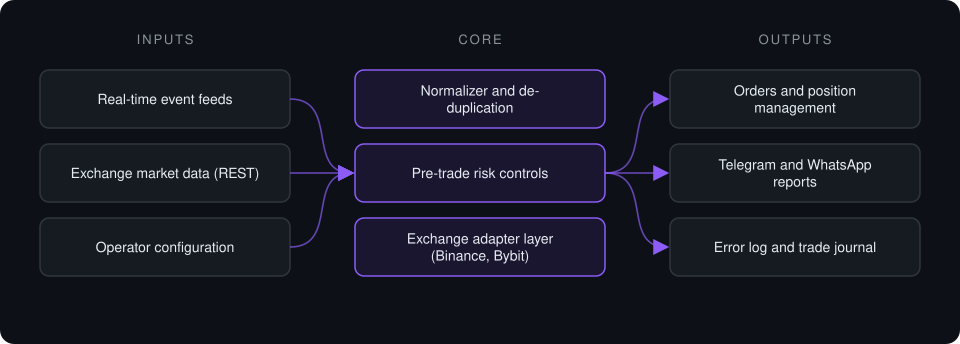

# Exchange Execution Pipeline

**Event-driven execution and monitoring system for crypto derivatives exchanges: ingest, validate, apply risk controls, execute through exchange APIs, and report every step.**

> **This is a proprietary project. Source code is private. This page describes the system's architecture and capabilities only.**

**Case study page:** [https://jryahia.github.io/showcase-exchange-execution-pipeline/](https://jryahia.github.io/showcase-exchange-execution-pipeline/)

## Problem it solves

Acting on time-sensitive market events by hand is slow and error-prone: messages arrive in bursts, duplicates slip through, order parameters have to match each exchange's precision rules, and nothing is logged. This system turns that into a single always-on service with validation, risk checks, exchange-correct order construction, and an audit trail, plus tooling to deploy and update it on a remote server.

## Architecture

1. Events stream in over a persistent connection, with no polling delay, and are normalized into one internal format.
2. A de-duplication window drops repeated events before they reach execution.
3. Each candidate order passes pre-trade risk controls and is validated against live market data and the exchange's tick-size and lot-size rules.
4. The exchange adapter places and manages orders through the exchange API, confirming filled quantities from order history.
5. Every action is reported to the operator on Telegram and WhatsApp and written to an error log and trade journal.

## Key features

- Event-driven ingestion from multiple real-time sources
- Exchange adapters for Binance Futures and Bybit behind one interface
- Pre-trade risk controls and exchange-precision validation
- Position management after entry, including partial closes
- Single-instance lock, graceful shutdown and timestamped error logging
- SSH deployment tooling that provisions and updates the service on a VPS

## Tech stack

      

## What it does in practice

- Replaces manual order entry with a monitored, logged pipeline that runs unattended on a server.
- Gives the operator a live feed of every decision and order, and a record to review afterwards.

> Not financial advice. Proprietary project, source code private. No performance figures are published.

---

Built by [Yahya Jarray](https://github.com/jryahia). Interested in a similar system? [Get in touch](mailto:yahiajarray43@gmail.com).

This repository contains no source code. It is a case study for a proprietary project. © Yahya Jarray.
